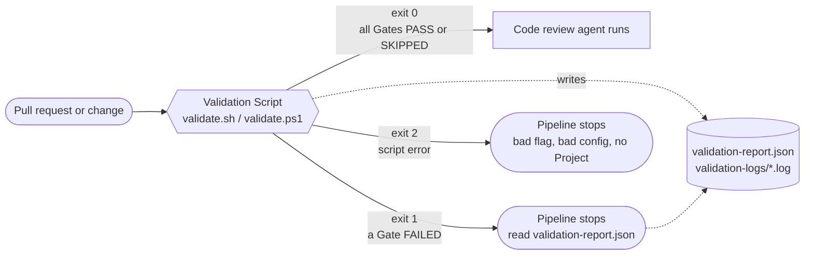
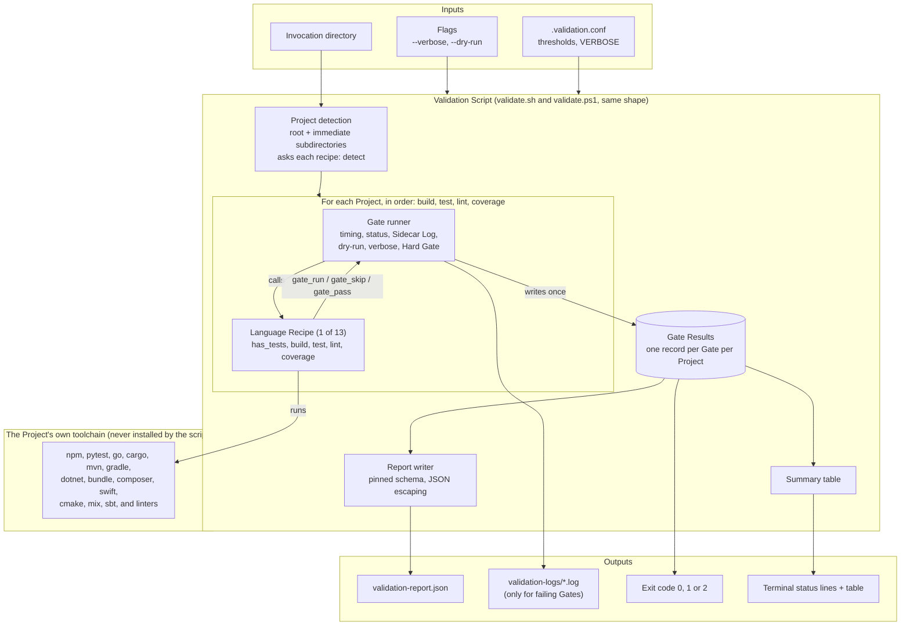
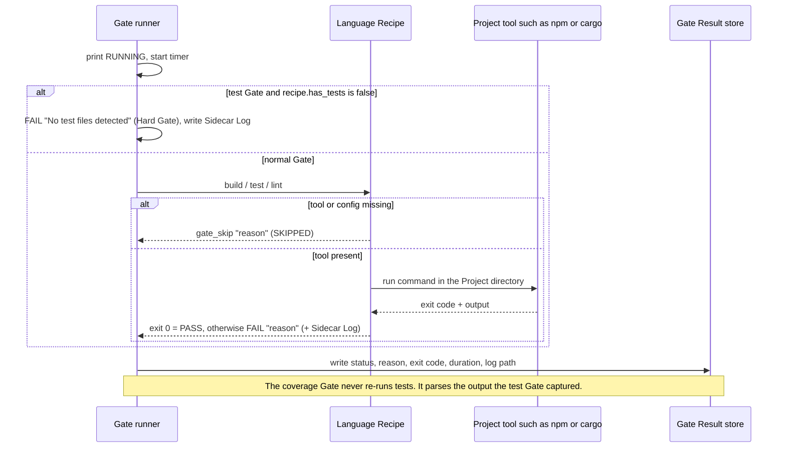
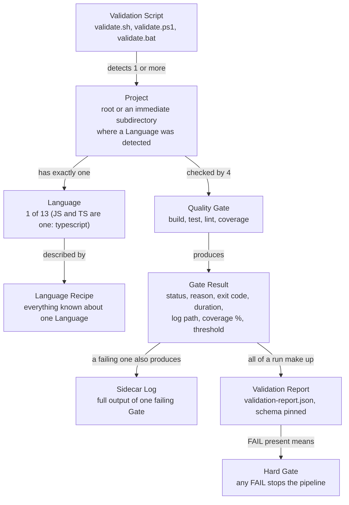
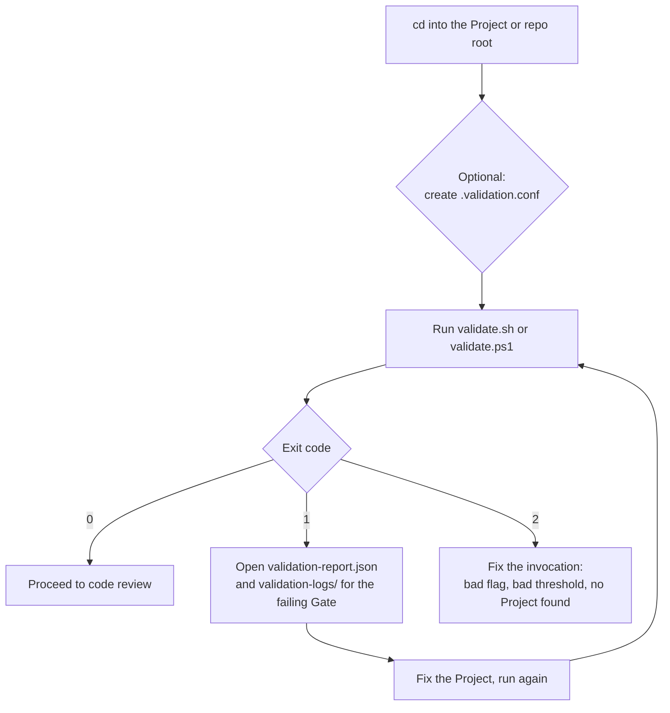

# Universal Validation Script

A self-contained, cross-platform quality gate that runs as the **first step of the code review agent pipeline**. It checks that a project builds, passes its unit tests, lints cleanly and meets a minimum line-coverage threshold. If any check fails, the pipeline stops and no review compute is spent on broken code.

- No LLM tokens, no network access, no package installs. It uses only the project's own toolchain.
- Written to the spec in `docs/spec-universal-validation-script.md`.
- Design decisions are recorded in `docs/adr/`:
  - [ADR-0001](docs/adr/0001-validation-hard-gate.md): the script is a hard gate.
  - [ADR-0002](docs/adr/0002-validation-report-json-schema.md): the JSON report schema is pinned.

## Files

| File | Purpose |
|---|---|
| `validate.sh` | POSIX sh implementation for macOS and Linux |
| `validate.ps1` | PowerShell 5.1+ implementation for Windows, macOS and Linux |
| `validate.bat` | Thin cmd.exe shim that calls `validate.ps1` |
| `.validation.conf.example` | Fully commented reference config |
| `fixtures/` | Minimal sample projects used by the tests |
| `tests/run.sh` | Test harness (POSIX sh, no `jq`) |

## Usage

Run the script from the directory you want to validate. It scans the current directory, not the script's own location.

```sh
cd /path/to/project
/path/to/validate.sh                  # macOS / Linux
/path/to/validate.sh --verbose        # also print full tool output
/path/to/validate.sh --dry-run        # print the commands, run nothing
```

```powershell
.\validate.ps1                        # Windows (or pwsh anywhere)
validate.bat                          # cmd.exe, delegates to validate.ps1
```

Only two flags exist: `--verbose` and `--dry-run`. Any other argument exits with code 2. There is deliberately no `--fail-fast` or warn-only flag.

### Exit codes

| Code | Meaning | Pipeline action |
|---|---|---|
| `0` | All gates PASS or SKIPPED | Proceed to code review |
| `1` | One or more gates FAIL | Stop |
| `2` | Script error (no projects found, bad flag, unreadable config) | Stop |

### Environment

- `NO_COLOR=1` turns off ANSI colour in the terminal output.

## Understanding the tool

This section is a map of the whole solution: what it is for, how the pieces fit, the vocabulary used in the code, what it covers, and how to use it. The vocabulary comes from `CONTEXT.md`.

### The problem and the idea

A code review agent spends compute (LLM tokens) on every review. That is wasted if the code does not even build or pass its own tests. The **Validation Script** is a cheap, deterministic first step: it runs the project's *own* tools, decides pass or fail, and stops the pipeline when the code is not fit to review. It is a **Hard Gate** (ADR-0001): any FAIL means a non-zero exit and no review.



### Architecture

Both scripts have the same structure, so a failure in one points straight at the matching code in the other. They share no code (ADR-0002 forbids runtime dependencies), and a parity test group guards that they agree.



What each part owns:

| Part | Owns | Does not do |
|---|---|---|
| **Language Recipe** | Everything about one Language: signal files, test-file patterns, the command per Gate, when to skip and why, how to read coverage | Write files, time itself, print status lines |
| **Gate runner** | Timing, PASS/FAIL/SKIPPED classification, Sidecar Logs, `--dry-run`, `--verbose`, and the rule "no test files is a FAIL" | Know any Language's commands |
| **Gate Result** | One record per Gate per Project, written once | Get re-derived by the report or the table |
| **Report writer** | The pinned `validation-report.json` schema, field order, nulls and escaping | Run anything |

### What happens to one Gate



### Terminology



| Term | Meaning in one line |
|---|---|
| **PASS / FAIL / SKIPPED** | A Gate's status. FAIL stops the pipeline. SKIPPED means "not applicable or tool not installed" and does **not** stop it. |
| **Threshold** | Minimum line coverage, default 80%, set globally or per Language in `.validation.conf`. |
| **Signal file** | A file whose presence identifies a Language, such as `go.mod` or `pom.xml`. |
| **Unit-test scoping** | Only unit tests run (for example `go test -short`, `cargo test --lib`, `pytest -m unit`). |

### Does it cover everything?

It covers the common path for 13 Languages. It deliberately does **not** try to be a full CI system.

| Area | Covered | Not covered |
|---|---|---|
| **Languages** | TypeScript/JavaScript, Python, Java, Kotlin, Go, Rust, .NET, Ruby, PHP, Swift, C/C++, Elixir, Scala | Any other Language is "not a Project" (exit 2 if nothing is detected) |
| **Gates** | Build, unit tests, lint, line coverage | Integration and end-to-end tests, security scanning, dependency audits, type checks beyond the build |
| **Coverage numbers** | Read for TypeScript/JavaScript (Jest, Vitest), Python (pytest-cov), Go, Rust (`cargo-llvm-cov` or `cargo-tarpaulin`), Java and Kotlin (JaCoCo), .NET (coverlet Cobertura), Ruby (SimpleCov), PHP (needs pcov or Xdebug), Swift (SwiftPM), Elixir (`mix test --cover`), Scala (sbt-scoverage, which measures statements) | C/C++ runs its tests but reports coverage as SKIPPED. Branch and function coverage are always `null`. A coverage tool the Project does not have gives SKIPPED with a hint, never a FAIL. |
| **Layout** | The invocation directory and its immediate subdirectories (monorepo packages), each gated separately | Anything nested deeper than one level |
| **Test frameworks** | Jest, Vitest, pytest, JUnit (Maven and Gradle), xUnit, NUnit and MSTest (`dotnet test`), RSpec, Minitest and Rails, PHPUnit, ExUnit, ScalaTest (sbt), XCTest (SwiftPM), CTest and `make test`, `go test`, `cargo test` | Mocha, Ava, Tap and node:test run through plain `npm test` (no Jest flags); coverage is read only if the script prints a table, for example with c8 or nyc |
| **Tools** | Uses what the Project already has | It never installs anything, so a missing tool means SKIPPED, not FAIL. A linter that is not configured in the Project (RuboCop, Credo, ktlint, scalastyle, `.clang-tidy`, clippy) is also SKIPPED |
| **Platforms** | macOS and Linux (`validate.sh`), PowerShell 7 (`validate.ps1`) | Windows PowerShell 5.1 and `validate.bat` have not been exercised |

The consequence to remember: **SKIPPED is not a pass of the underlying check.** A machine without Go will report a Go Project as SKIPPED and exit 0, except that "no test files" is always a FAIL. Run the script on a machine that has the Project's toolchain.

### How it is used



Typical commands:

```sh
cd /path/to/project && /path/to/validate.sh              # normal run
/path/to/validate.sh --dry-run                           # show the commands, run nothing
/path/to/validate.sh --verbose                           # stream full tool output
printf 'COVERAGE_THRESHOLD_GO=70\n' > .validation.conf    # per-Language threshold
```

To add a Language, see "Script structure" below.

## How it works

### 1. Project detection

The script scans the invocation directory and each **immediate subdirectory** (depth 1, symlinks not followed). A directory that contains language signal files is treated as an independent project. Root and sub-directory signals are never merged, so a monorepo's `frontend/` and `backend/` are gated separately. If no signals are found, the script exits with code 2.

A **workspace root** owns its subprojects. If the root has a solution file (`*.sln`, `*.slnx`), a Maven `<modules>` list, a Gradle `include`, a Cargo `[workspace]` or a `go.work`, then same-family subdirectories are part of that build and are **not** separate Projects. Without this a standard C# layout (solution at the root, `src/App` and `tests/App.Tests` below it) would be gated three times, and the library project, which has no tests, would fail the Hard Gate.

Detection uses file presence only:

| Language | Signal files |
|---|---|
| JS/TS (slug `typescript`) | `package.json` |
| Python | `pyproject.toml`, `setup.py`, `setup.cfg`, `requirements.txt` |
| Java | `pom.xml` or `build.gradle` (no `.kt` files) |
| Kotlin | `build.gradle.kts`, or `build.gradle` with `.kt` files |
| Go | `go.mod` |
| Rust | `Cargo.toml` |
| .NET (C#) | `*.csproj`, `*.sln`, `*.slnx`, `global.json` |
| Ruby | `Gemfile` |
| PHP | `composer.json` |
| Swift | `Package.swift`, `*.xcodeproj` |
| C/C++ | `CMakeLists.txt`, or `Makefile` with `.c`/`.cpp` files |
| Elixir | `mix.exs` |
| Scala | `build.sbt` |

### 2. The four gates

For every project, the gates always run in this order. A failure in one gate does not stop the others. The full picture is reported in a single run, and the exit code is decided at the end.

| Gate | What it does | SKIPPED when |
|---|---|---|
| **Build** | Runs the ecosystem's build (for .NET, `dotnet restore` then `dotnet build`) | No build step applies |
| **Test** | Runs unit tests only (see below) and collects coverage in the same run | Never. No test files is a **FAIL** ("No test files detected") |
| **Lint** | JS/TS uses `./node_modules/.bin/eslint .` (never `npx`, so no network) | The linter or its config is missing |
| **Coverage** | Parses the coverage captured during the test gate and compares **line** coverage to the threshold | The coverage tool is not installed, such as Rust without `cargo-llvm-cov` or `cargo-tarpaulin` |

Tests run **once**. The coverage gate only parses output captured by the test gate.

Unit-test scoping follows each ecosystem's convention, for example:
- Go: `go test -short ./...`
- Rust: `cargo test --lib`
- Python: `pytest -m unit`, falling back to the full suite if no tests are marked
- JS/TS: Jest `--testPathPattern='(unit|spec)'`

The full table is in the spec.

### Script structure

Both scripts have the same shape (see `CONTEXT.md` for the vocabulary):

1. **Detection** asks each Language Recipe whether its signal files are present, in a fixed order.
2. **Language Recipes** are one function per Language (`_recipe_<lang>` in `validate.sh`, `Recipe-<lang>` in `validate.ps1`). A recipe answers `detect`, `has_tests`, `build`, `test`, `lint` and `coverage` for one Project. It holds everything specific to that Language: signal files, test-file patterns, the command for each Gate, when to skip and why, and how to read coverage from the test run's output. Recipes never write files, time themselves or print status lines.
3. **The gate runner** (`_run_gate` / `Invoke-Gate`) runs every Gate. It owns timing, status classification, Sidecar Logs, `--dry-run` and `--verbose`, and the Hard Gate rule that a Project with no test files fails its test Gate. A recipe reports its outcome with `gate_run` (run a command, with a failure reason), `gate_skip` or `gate_pass` (`Invoke-GateRun`, `Set-GateSkip`, `Set-GatePass` in PowerShell).
4. **Gate Results** hold one record per Gate per Project. They are read only by the report writer and the summary table.
5. **The report writer** owns the pinned `validation-report.json` schema.

**Adding a Language:** write a `_recipe_<lang>` function in `validate.sh` and a `Recipe-<lang>` function in `validate.ps1` with the same reasons and commands, add the Language to the detection order (`_detect_lang` / `Get-Lang`), add it to `CHAR_LANGS` and `_char_make_project` in `tests/characterization.sh`, then run `UPDATE_GOLDEN=1 ./tests/run.sh` and review the new golden files.

### 3. Outputs

Everything is written relative to the invocation directory.

- **Terminal:** live status lines per gate (PASS green, FAIL red, SKIPPED yellow, RUNNING cyan), then a summary table.
- **`validation-report.json`:** always written, even on failure. Not written in `--dry-run`.
- **`validation-logs/<project>-<lang>-<gate>.log`:** full stdout and stderr of a failing gate. PASS and SKIPPED gates produce no log. Not created in `--dry-run`.

### The JSON report

The schema is pinned (ADR-0002) and treated as a public contract. The downstream review agent parses it directly.

```jsonc
{
  "validator_version": "1.0.0",
  "timestamp": "2026-10-11T14:32:53Z",       // ISO-8601 UTC
  "invocation_dir": "/abs/path",
  "overall_pass": false,
  "projects": [
    {
      "project_dir": "root",                 // or the subdirectory name
      "language": "typescript",
      "gates": {
        "build":    { "status": "PASS|FAIL|SKIPPED", "duration_seconds": 0, "exit_code": 0, "reason": null, "log_file": null },
        "test":     { /* same fields */ },
        "lint":     { /* same fields */ },
        "coverage": { /* same fields, plus: */
                      "line_coverage_pct": 92, "branch_coverage_pct": null,
                      "function_coverage_pct": null, "threshold_pct": 80 }
      }
    }
  ],
  "summary": { "total_projects": 1, "total_gates_run": 4, "passed": 3, "failed": 1, "skipped": 0 }
}
```

Consumers should check `validator_version` and refuse a report whose version they don't recognise. **Any schema change requires bumping `VALIDATOR_VERSION` in both scripts and updating the consuming agent.**

The report is a single-line JSON blob for the `projects` array, so use a real JSON parser in agents. The test harness uses `grep -o` only to avoid a `jq` dependency.

### Configuration (`.validation.conf`)

Optional. Place it in the invocation directory. Plain `KEY=VALUE` INI format, `#` comments, and unknown keys are ignored. Copy `.validation.conf.example` to start.

| Key | Default | Effect |
|---|---|---|
| `COVERAGE_THRESHOLD` | `80` | Global line-coverage floor (0–100) |
| `COVERAGE_THRESHOLD_<LANG>` | none | Per-language override, such as `COVERAGE_THRESHOLD_PYTHON=85` or `COVERAGE_THRESHOLD_TYPESCRIPT=70` |
| `VERBOSE` | `false` | Same as `--verbose` |
| `FAIL_FAST` | `false` | Reserved and ignored |

CLI flags always win over config values. A threshold that is not an integer 0–100 is a script error (exit 2).

## Testing

```sh
./tests/run.sh             # run everything
./tests/run.sh --verbose   # also show validate.sh output
```

The harness runs `validate.sh` against each directory in `fixtures/`, then asserts on the exit code and the fields in `validation-report.json`. The only seam is the script itself, treated as a black box. It prints PASS or FAIL per assertion plus a summary, and exits non-zero if anything fails.

**Prerequisites** (the script never installs anything):
- Node and npm. The JS/TS fixtures ship with their `node_modules` committed so they run offline.
- `pwsh` (optional) for the PowerShell parity group.
- `pytest`, `pytest-cov` and `ruff` for the Python fixtures. One way to install them:
  ```sh
  python3 -m venv .venv && . .venv/bin/activate && pip install pytest pytest-cov ruff
  ```
  `./tests/run.sh` uses `.venv/bin` automatically when it exists.

**Fake-toolchain characterization (Group 13).** `tests/characterization.sh` builds a throwaway Project for each of the 13 Languages and runs the script with a `PATH` that holds only stub executables and a few system utilities, so it needs no real toolchain and gives the same result on any machine. Each Language runs three times: every tool present and exiting 0 (`ok`), no tools (`missing`), and every tool exiting 1 (`fail`). The commands each Gate issued and each Gate Result are compared with `tests/golden/<lang>.<scenario>.txt`. After an intended behaviour change, regenerate with `UPDATE_GOLDEN=1 ./tests/run.sh` and review the diff.

**Adding a test case:**
1. `exit_code=$(run_validate "$FIXTURES/<fixture>" [flags])`
2. `assert_exit_code <expected> "$exit_code" "<description>"`
3. `assert_json_field "$FIXTURES/<fixture>/validation-report.json" '"key"' <value> "<description>"`, or `assert_file_exists <path> "<description>"`

| Fixture | Expected result |
|---|---|
| `js-ts-passing` | All gates pass, exit 0 |
| `js-ts-test-fail` | Test gate FAIL, exit 1 |
| `js-ts-no-tests` | Test gate FAIL ("No test files"), exit 1 |
| `js-ts-no-eslint-config` | Lint SKIPPED, exit 0 |
| `js-ts-low-coverage` | Coverage FAIL, exit 1 (passes with `COVERAGE_THRESHOLD_TYPESCRIPT=10`) |
| `python-passing` | Exit 0 |
| `monorepo` | Two projects detected, exit 0 |
| `no-signals` | Exit 2 |

Generated `validation-report.json` and `validation-logs/` inside `fixtures/` are git-ignored.

## Status and known gaps

- `./tests/run.sh` passes: 125 assertions, 0 failures (with the `.venv` above), on macOS with PowerShell 7.6 installed. Group 11 compares `validate.ps1` against `validate.sh` on every fixture (exit code, `overall_pass`, gate statuses, summary counts). It shows PENDING when `pwsh` is not on the `PATH`.
- `validate.ps1` has only been run under PowerShell 7 on macOS. It avoids 7-only syntax, but Windows PowerShell 5.1 and `validate.bat` have not been exercised.
- `fixtures/*/node_modules` is committed (about 33,000 files) so the JS fixtures run offline. Consider vendoring less.
- `fixtures/monorepo/frontend/.eslintrc.json` is a legacy config that ESLint 10 ignores. It has no effect today because that fixture does not install ESLint.
- Out of scope: integration tests, security scanning, auto-fixing lint, installing missing tools, parallel gates, per-gate timeouts, and languages beyond the 13 above.

## Working on this repo

- Issues live in GitHub Issues, managed with `gh`. See `docs/agents/issue-tracker.md` and `docs/agents/triage-labels.md`.
- The source-of-truth documents are the spec, the ADRs, and `docs/universal-validation-script-prompt.md` (the prompt that drives script generation).
- If the prompt is regenerated, bump `VALIDATOR_VERSION` and update the consuming agent.
